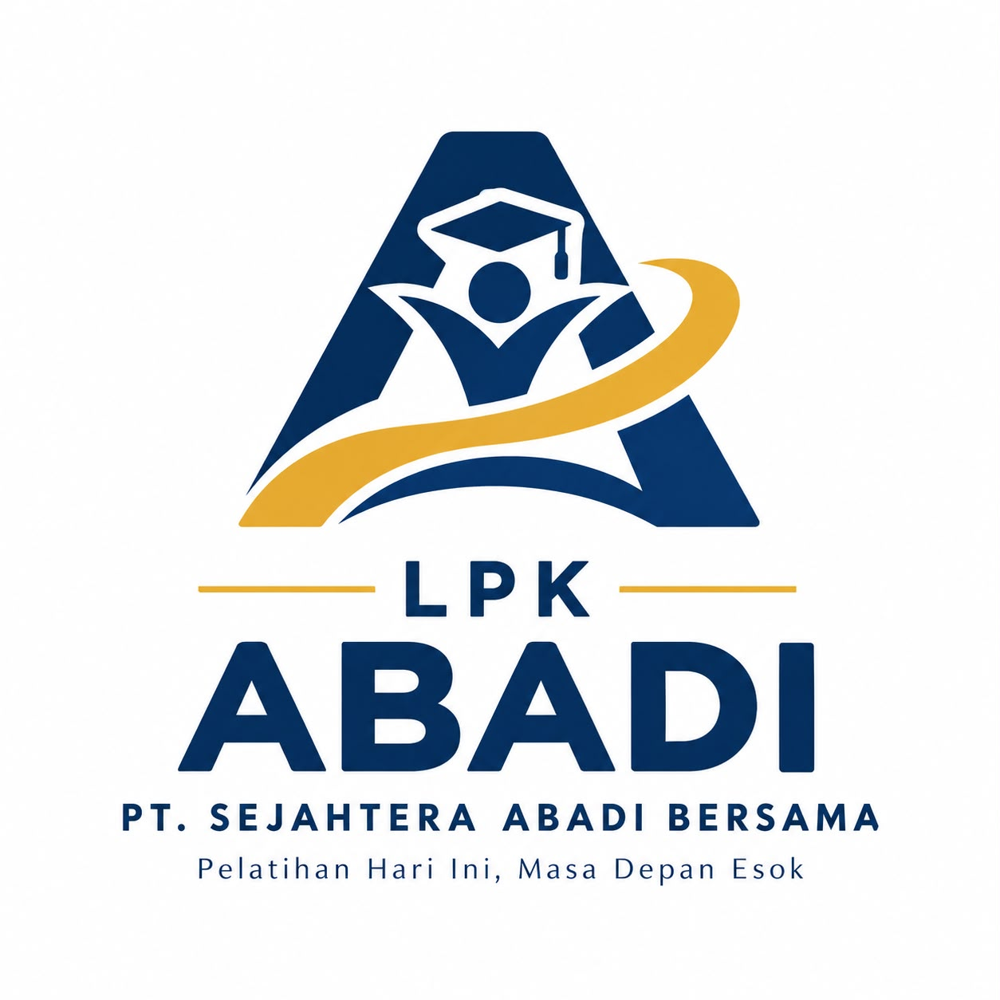

# PT. Sejahtera Abadi Bersama — Website & Sistem Manajemen LPK

Sistem informasi dan platform operasional resmi untuk **PT. Sejahtera Abadi Bersama** (Lembaga Pelatihan Kerja). Sistem ini mencakup portal publik, katalog program pelatihan kerja dan bahasa, formulir pendaftaran bertahap, dashboard peserta pelatihan, serta dashboard administrasi operasional dan pelaporan berbasis Role-Based Access Control (RBAC).



---

## 🏗️ Arsitektur Teknologi

- **Frontend:** Next.js (App Router), TypeScript (Strict Mode), Tailwind CSS, Lucide Icons, React Hook Form + Zod.
- **Backend API:** Go 1.22+, Router Chi, Driver pgx/v5 (PostgreSQL), JWT Verifier (Supabase Auth JWKS/Secret), RBAC Engine.
- **Database & Auth:** Supabase PostgreSQL (UUID PK, RLS Policies), Supabase Auth, Supabase Storage (Private Documents Bucket).
- **Hosting:** Frontend on Vercel, Backend on Cloud Container (Docker / Railway / Render / Fly.io), Database on Supabase.

---

## 📁 Struktur Monorepo

```
lpk-sejahtera/
├── apps/
│   └── web/                   # Next.js Frontend Application
│       ├── public/            # Static assets (logo.jpeg, dll)
│       └── src/
│           ├── app/           # App Router: (public), (auth), (student), (admin)
│           ├── components/    # Reusable UI & Layout Components
│           ├── lib/           # Supabase client, API client, utils
│           └── types/         # TypeScript Domain Types
├── services/
│   └── api/                   # Go REST API Service (/api/v1)
│       ├── cmd/api/           # Entrypoint main.go
│       ├── internal/          # Config, Domain, Handler, Service, Repo, Middleware
│       ├── migrations/        # SQL Migrations (DDL, RLS, Seed)
│       └── tests/             # Go Unit & Integration Tests
├── docs/                      # Arsitektur, Skema DB, OpenAPI Spec, Deployment Guide
├── .github/workflows/         # CI/CD Pipeline
├── docker-compose.yml         # Local development environment
├── .env.example               # Template environment variables
└── README.md
```

---

## 🎨 Identitas Brand & Desain

- **Nama Resmi:** PT. Sejahtera Abadi Bersama
- **Jenis:** Lembaga Pelatihan Kerja (LPK)
- **Primary Color:** Navy Blue (`#163A5F`)
- **Secondary Color:** Teal (`#16A6A1`)
- **Backgrounds:** Putih (`#FFFFFF`) & Soft Gray (`#F5F7FA`)
- **Logo Utama:** `logo.jpeg`
- **Typography:** Plus Jakarta Sans / Inter

---

## 🚀 Panduan Menjalankan Secara Lokal

### 1. Prasyarat
- Node.js 18+ & npm/pnpm
- Go 1.22+
- Docker & Docker Compose (atau instance Supabase lokal / cloud)

### 2. Konfigurasi Environment
Salin template `.env.example`:
```bash
cp .env.example .env
```
Isi konfigurasi Supabase (`SUPABASE_URL`, `SUPABASE_ANON_KEY`, `SUPABASE_SERVICE_ROLE_KEY`, `DATABASE_URL`).

### 3. Migrasi Database Supabase
Jalankan file SQL di `services/api/migrations/` secara berurutan:
1. `000001_init_schema.up.sql` (Tabel & Relasi)
2. `000002_rls_policies.up.sql` (Row Level Security)
3. `000003_seed_data.up.sql` (Role, Permission, Kategori & Data Awal)

### 4. Menjalankan Backend Go API
```bash
cd services/api
go run cmd/api/main.go
# API berjalan di http://localhost:8080/api/v1
# Healthcheck: http://localhost:8080/healthz
```

### 5. Menjalankan Frontend Next.js
```bash
cd apps/web
npm install
npm run dev
# Frontend berjalan di http://localhost:3000
```

---

## 🔐 Keamanan & RBAC (Role-Based Access Control)

Hak akses diterapkan berlapis:
1. **Frontend Guard:** Route protection & context-based redirection.
2. **Backend Middleware:** Verifikasi JWT Supabase dan pengecekan izin eksplisit per endpoint.
3. **Database RLS:** PostgreSQL Row Level Security membatasi isolasi data per pengguna (`auth.uid()`).

Role yang didukung:
- `super_admin`: Akses penuh sistem, manajemen user administratif, audit log.
- `admin`: Pengelolaan program, pendaftaran, kelas, pengajar, dan konten.
- `staff`: Verifikasi berkas, operasional kehadiran, dan pencatatan nilai/jadwal.
- `student`: Akses profil, pengajuan pendaftaran, jadwal kelas pribadi, berkas dan sertifikat pribadi.

---

## 📄 Dokumentasi Terkait
- [Arsitektur Sistem](docs/architecture.md)
- [Skema & ERD Database](docs/database-schema.md)
- [Spesifikasi OpenAPI](docs/api-spec.yaml)
- [Panduan Deployment](docs/deployment.md)
